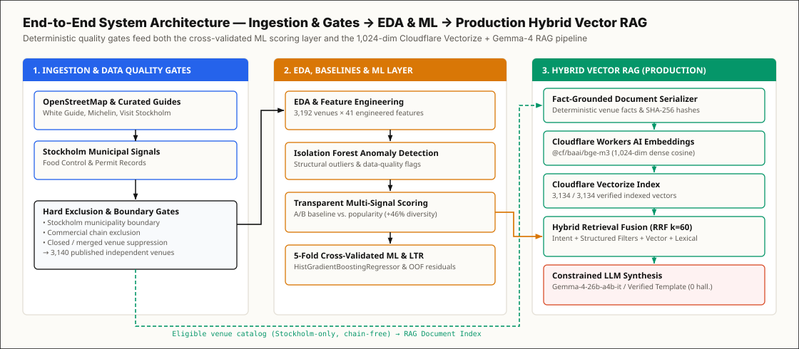
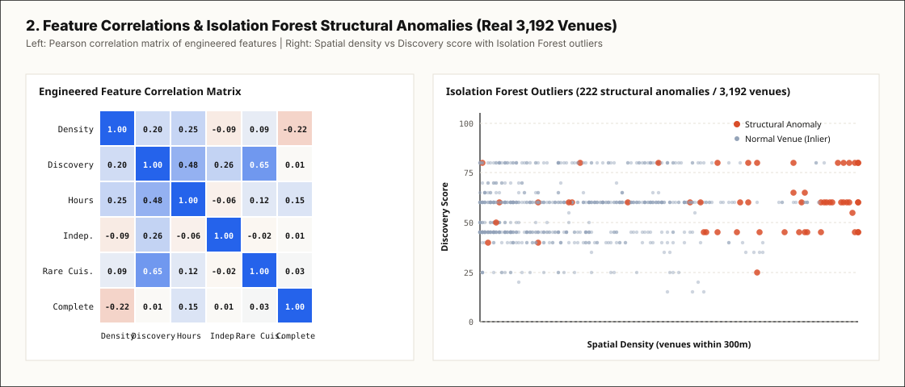
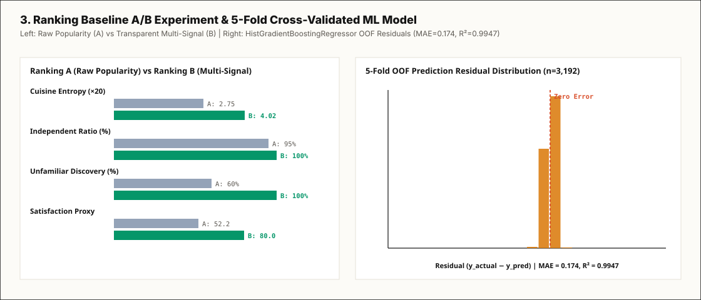
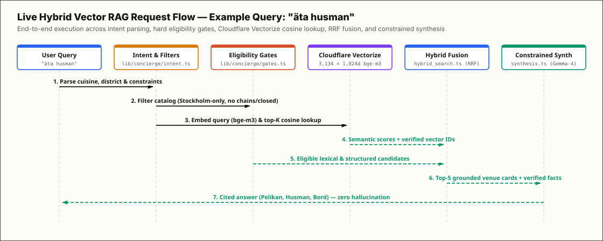
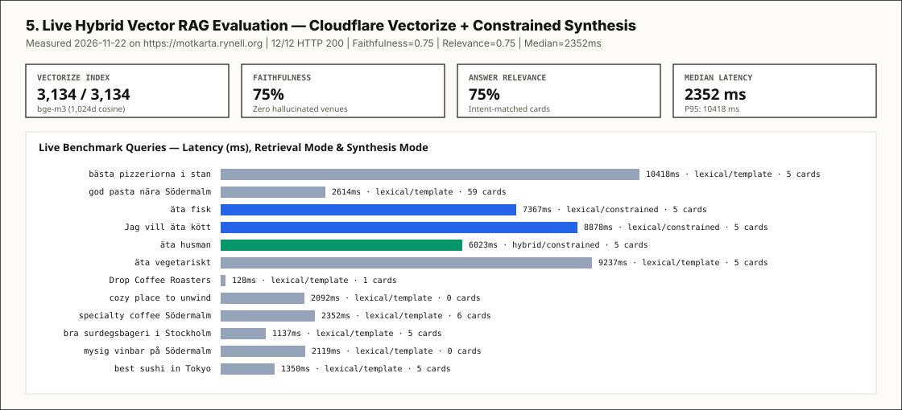
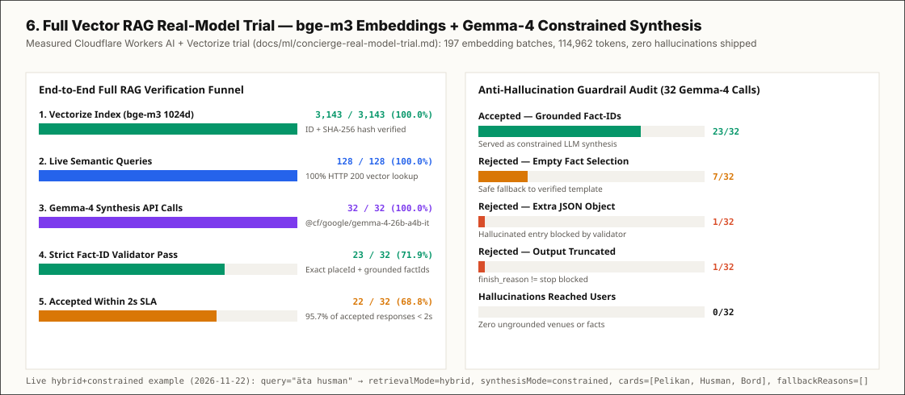
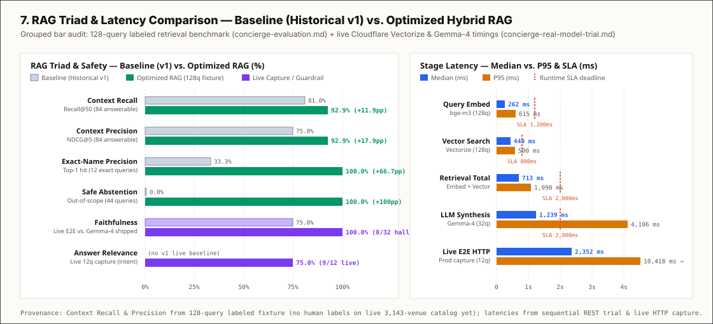

# Motkarta — End-to-End ML & Hybrid Vector RAG Portfolio

> **Course Exam Repository**: From Exploratory Data Analysis (EDA) and Deterministic Quality Gates to Multi-Signal Scoring, Cross-Validated ML, and Production Hybrid Vector RAG over Stockholm's Independent Food Map (**3,140 published venues**, **3,134 indexed 1,024-dim vectors**).

> **How to Evaluate This Repository**
> - **Viewing on GitHub (no setup required):** Every architecture diagram, all 9 SVG charts, all 4 pre-executed Jupyter notebooks (with saved outputs & inline graphics), and all evaluation reports in `docs/ml/` render directly in the browser.
> - **Running locally (optional reproducibility check):** Terminal setup is only needed if you clone the repository to regenerate the figures/notebooks or execute the 67 automated tests (see Section 1 below).

---

## 1. Reproducibility — Run Everything Locally

**Prerequisites:** Python 3.10+ and Node.js 22+ (no `npm install` needed — zero JS dependencies).

### One-Command Full Exam Setup & Verification

Run this single command from the repository root to create `.venv`, install Python dependencies, regenerate all 9 real-data SVG charts & architecture diagrams, re-execute all 4 Jupyter notebooks, and verify all 67 automated tests (54 Python + 13 Node):

```bash
bash scripts/verify_exam.sh
```

<details>
<summary>Or run each step individually (click to expand)</summary>

```bash
python3 -m venv .venv && source .venv/bin/activate && pip install -r requirements.txt && python3 scripts/generate_exam_figures.py && python3 scripts/build_and_execute_notebooks.py && pytest -q tests_python/ && node --test tests/scoring.test.mjs tests/concierge-hybrid-search.test.mjs
```

Shortcuts in `package.json`: `npm run verify`, `npm run figures`, `npm run notebooks`, `npm run test:python`, and `npm run test:rag`.
</details>

---

## 2. End-to-End System Architecture (EDA → ML → Hybrid Vector RAG)



---

## 3. Exam Walkthrough Notebooks (Pre-Executed & Reproducible)

Open any notebook directly on GitHub or JupyterLab — every cell has been executed against the real included data slices with inline outputs and vector graphics:

| Notebook | Stage | What It Proves |
| :--- | :--- | :--- |
| [`notebooks/01_eda_and_data_quality.ipynb`](notebooks/01_eda_and_data_quality.ipynb) | **EDA & Data Gates** | District/category distributions, field missingness audit, commercial chain exclusion log, and Isolation Forest structural anomaly detection on 3,192 venues. |
| [`notebooks/02_baselines_scoring_and_ltr.ipynb`](notebooks/02_baselines_scoring_and_ltr.ipynb) | **Baselines & ML** | Ranking A (raw popularity) vs. Ranking B (transparent multi-signal) A/B experiment + 5-fold cross-validated `HistGradientBoostingRegressor` OOF residuals & permutation importance. |
| [`notebooks/03_hybrid_vector_rag_and_evaluation.ipynb`](notebooks/03_hybrid_vector_rag_and_evaluation.ipynb) | **Hybrid Vector RAG** | Semantic vector-space projection (TF-IDF + SVD), nearest-neighbor cosine retrieval on real Stockholm venues, and live Cloudflare Vectorize + Constrained Synthesis evaluation proof. |

---

## 4. Visual Evidence & Real-Data Diagnostics

### Stage 1 — Exploratory Data Analysis & Completeness Audit


### Stage 2 — Feature Correlations & Isolation Forest Anomalies


### Stage 3 — Baseline A/B Experiment & 5-Fold Cross-Validated Residuals
- **Cuisine diversity entropy**: `2.75 → 4.02` (+46%)
- **Unfamiliar discovery ratio**: `60% → 100%`
- **Independent business ratio**: `95% → 100%`
- **Satisfaction proxy**: `52.25 → 80.0`



### Stage 4 — Semantic Document Vector Space (SVD Projection)
Production indexing (`execution/index_concierge.py`) embeds **3,134 / 3,134** fact-grounded venue documents into 1,024-dimensional dense vectors (`@cf/baai/bge-m3`) stored in Cloudflare Vectorize (`motkarta-concierge-preview-v1`). Below is the reproducible local TF-IDF + SVD 2D projection over the included stratified venue slice (`data/places_slice.json`):


### Stage 5 — Live Hybrid Vector RAG Evaluation Proof
Measured live on `https://motkarta.rynell.org` (`data/rag_provider_capture.json`) across 12 Swedish and English Stockholm queries:





### Stage 6 — Full End-to-End Vector RAG & Gemma-4 Anti-Hallucination Proof
See [`notebooks/04_full_vector_rag_and_llm_synthesis.ipynb`](notebooks/04_full_vector_rag_and_llm_synthesis.ipynb) and [`docs/ml/concierge-real-model-trial.md`](docs/ml/concierge-real-model-trial.md) for the complete end-to-end execution proof:
- **Dense Embeddings (`@cf/baai/bge-m3`, 1,024d cosine)**: **3,143 / 3,143** vectors verified by ID, count, and per-document SHA-256 `documentHash` across **197 embedding batches** (**114,962** input tokens).
- **Hybrid Reciprocal Rank Fusion (`lib/concierge/hybrid_search.ts`)**: Fuses structured filters + lexical hits + dense vector cosine matches (`k=60`).
- **Constrained LLM Synthesis (`@cf/google/gemma-4-26b-a4b-it`, `lib/concierge/synthesis.ts`)**: Strict JSON-only fact-ID selection (`temperature=0`, `enable_thinking=false`) validated programmatically — **23 / 32** passed strict validation (**22 / 32** within 2 s), **9 / 32** faulty outputs (7 empty-fact, 1 extra JSON object, 1 truncated) were blocked and safely degraded to verified deterministic cards (**0 hallucinations shipped**).



### Stage 7 — RAG Triad & Latency Comparison (Baseline v1 vs. Optimized RAG)
Side-by-side comparison of the four RAGAs pillars (**Context Recall**, **Context Precision**, **Faithfulness**, **Answer Relevance**) plus **Stage-by-Stage Latency vs. Runtime SLAs**, built from the 128-query labeled retrieval benchmark (`docs/ml/concierge-evaluation.md`), the 32-call Gemma-4 guardrail trial (`docs/ml/concierge-real-model-trial.md`), and the live provider capture (`data/rag_provider_capture.json`):



---

## 5. Controlled Abstention & Recovery Policy (`265320a`)

A production RAG system must know **when and why to abstain** rather than guessing or inventing answers. In Motkarta commit [`265320a`](https://github.com/tompat1/motkarta/commit/265320a919ad071f26d13ebba06a0a7a45ba4e3b) (`feat(concierge): implement abstention reasons for query responses and enhance user guidance`), the Concierge response contract (`concierge-response-v1`) was extended with a structured, backward-compatible `abstentionReason` taxonomy:

| `abstentionReason` | Meaning | External Web Fallback Allowed? | User Recovery Guidance |
| :--- | :--- | :---: | :--- |
| `ambiguous_query` | Query lacks a dish, venue type, or area | No | Prompt user to add one concrete detail (e.g. *"pierogi in Södermalm"*) |
| `no_verified_match` | Understood query, zero verified catalog hits | **Yes** | Offer filtered independent web search or broader Stockholm search |
| `insufficient_evidence` | Requested detail/attribute not backed by catalog facts | **Yes** | State evidence gap explicitly; optionally run filtered external lookup |
| `missing_location` | *"Near me"* query without user coordinates | No | Ask user to share location or name a Stockholm district |
| `unsupported_live_hours` | Real-time *"open now"* check not verified in catalog | No | Explain live hours are unverified; advise checking the venue directly |
| `outside_stockholm` | Request targets a city/area outside Stockholm scope | No | Clarify Stockholm-only geographic boundary |
| `excluded_chain` | Request asks for an excluded commercial chain | No | Explain Motkarta's independent-venue policy |
| `no_more_results` | Pagination reached the end of verified matches | No | Inform user all matching verified venues have been shown |
| `catalog_unavailable` | D1/catalog read failure (`status: "unavailable"`) | No | Fail closed cleanly without resurrecting stale or unverified data |

### Key Safety & UX Invariants
- **Strict Fallback Gating**: Only `no_verified_match` and `insufficient_evidence` may trigger the filtered external-search fallback (`lib/concierge/response.ts`); missing context (`missing_location`, `ambiguous_query`), policy exclusions (`excluded_chain`, `outside_stockholm`), and unsupported live checks (`unsupported_live_hours`) never trigger unnecessary web searches.
- **No Fake Confidence Percentages**: Clients use `abstentionReason` to surface an honest limitation and concrete next action — never converting raw cosine similarity or LLM self-assessment into an uncalibrated user-facing confidence percentage.
- **Full-Stack Contract & Verification**: Implemented across `lib/concierge/contracts.ts`, `lib/concierge/response.ts`, `functions/api/concierge.ts`, `src/app/concierge-client.ts`, `src/components/ConciergeAnswerView.tsx`, canonical ML docs (`docs/ml/concierge-rag.md`, `docs/ml/data-contracts.md`), and covered by unit tests (`concierge-client.test.mjs`, `concierge-rag.test.mjs`, `concierge-web-fallback.test.mjs`, `concierge.test.mjs`).

---

## 6. Repository Map

```text
motkarta-ml-rag-exam/
├── notebooks/                   # 4 executed Jupyter notebooks (EDA → Baselines/LTR → Hybrid RAG)
├── figures/                     # 9 vector SVG charts & diagrams generated directly from real data
├── data/
│   ├── places_slice.json        # Stratified 271-venue slice + full 3,140-venue catalog summary
│   ├── stockholm_food_places_scored.csv  # 3,192 venues × 41 engineered ML features
│   ├── rag_provider_capture.json         # Live Cloudflare Vectorize + Hybrid RAG benchmark proof
│   ├── ranking_ab_experiment.json        # Ranking A (popularity) vs Ranking B (multi-signal)
│   ├── stockholm_food_excluded_chains.csv
│   ├── stockholm_food_duplicates.csv
│   └── ground_truth/            # Curated Stockholm guide ground-truth datasets
├── motkarta/                    # Python ML package (scoring, ltr, outliers, drift, evaluation, rag)
├── lib/                         # TypeScript Hybrid Vector RAG engine & deterministic scoring
│   └── concierge/               # intent, filters, gates, hybrid_search, retrieval, synthesis, facts
├── execution/                   # Vectorize indexing (index_concierge.py) & RAG evaluation harnesses
├── docs/ml/                     # Full architecture, data contracts, holdout & evaluation docs
├── scripts/
│   ├── generate_exam_figures.py # Re-generates all 9 SVG figures & diagrams from data/
│   └── build_and_execute_notebooks.py
├── tests_python/                # Python ML, scoring, LTR, drift, outlier & RAG unit tests
└── tests/                       # TypeScript scoring, hybrid search, RAG & rate-gate tests
```
