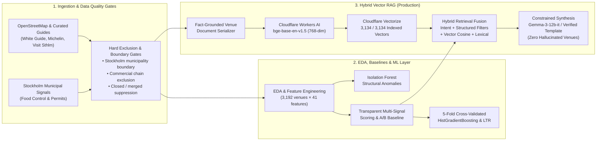
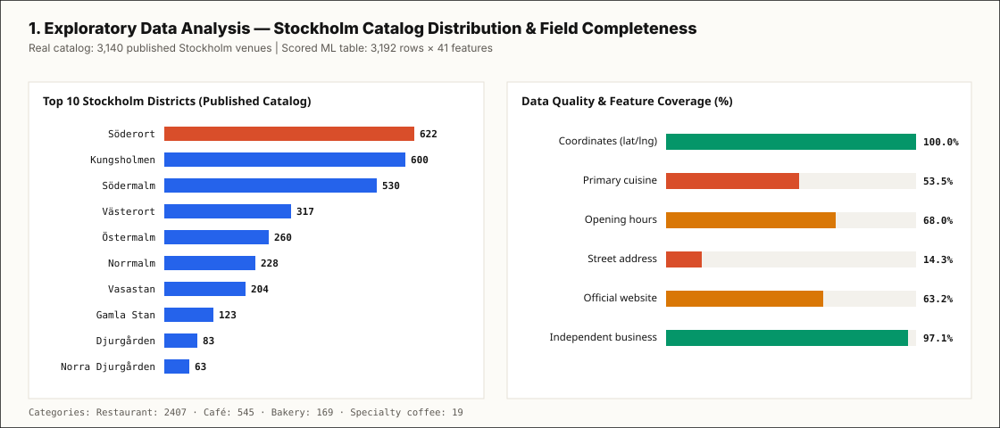
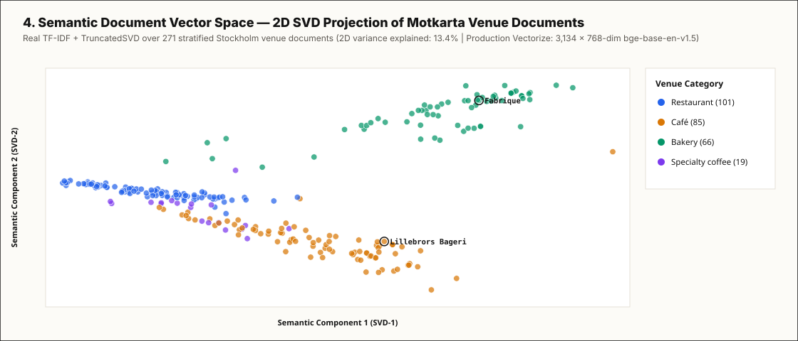
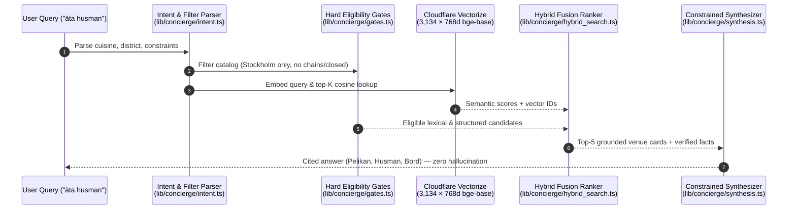

# Motkarta — End-to-End ML & Hybrid Vector RAG Portfolio

> **Course Exam Repository**: From Exploratory Data Analysis (EDA) and Deterministic Quality Gates to Multi-Signal Scoring, Cross-Validated ML, and Production Hybrid Vector RAG over Stockholm's Independent Food Map (**3,140 published venues**, **3,134 indexed 768-dim vectors**).

---

## 1. Reproducibility — Run Everything Locally

**Prerequisites:** Python 3.10+ and Node.js 22+ (no `npm install` needed — zero JS dependencies).

```bash
# 0. Install Python dependencies (recommended inside a virtual environment)
python3 -m venv .venv && source .venv/bin/activate
pip install -r requirements.txt

# 1. Regenerate all 5 real-data SVG charts (deterministic)
python3 scripts/generate_exam_figures.py

# 2. Re-execute all 3 exam Jupyter notebooks
python3 scripts/build_and_execute_notebooks.py

# 3. Run Python ML & RAG test suite (54 tests)
pytest -q tests_python/

# 4. Run TypeScript Scoring & Hybrid RAG test suite (13 tests, Node 22+)
node --test tests/scoring.test.mjs tests/concierge-hybrid-search.test.mjs
```

> All 4 steps are also available as shortcuts in `package.json`: `npm run figures`, `npm run notebooks`, `npm run test:python`, and `npm run test:rag`.

---

## 2. End-to-End System Architecture (EDA → ML → Hybrid Vector RAG)



---

## 3. Exam Walkthrough Notebooks (Pre-Executed & Reproducible)

Open any notebook directly on GitHub or JupyterLab — every cell has been executed against the real included data slices with inline outputs and vector graphics:

| Notebook | Stage | What It Proves |
| :--- | :--- | :--- |
| [`notebooks/01_eda_and_data_quality.ipynb`](notebooks/01_eda_and_data_quality.ipynb) | **EDA & Data Gates** | District/category distributions, field missingness audit, commercial chain exclusion log, and Isolation Forest structural anomaly detection on 3,192 venues. |
| [`notebooks/02_baselines_scoring_and_ltr.ipynb`](notebooks/02_baselines_scoring_and_ltr.ipynb) | **Baselines & ML** | Ranking A (raw popularity) vs. Ranking B (transparent multi-signal) A/B experiment + 5-fold cross-validated `HistGradientBoostingRegressor` OOF residuals & permutation importance. |
| [`notebooks/03_hybrid_vector_rag_and_evaluation.ipynb`](notebooks/03_hybrid_vector_rag_and_evaluation.ipynb) | **Hybrid Vector RAG** | Semantic vector-space projection (TF-IDF + SVD), nearest-neighbor cosine retrieval on real Stockholm venues, and live Cloudflare Vectorize + Constrained Synthesis evaluation proof. |

---

## 4. Visual Evidence & Real-Data Diagnostics

### Stage 1 — Exploratory Data Analysis & Completeness Audit


### Stage 2 — Feature Correlations & Isolation Forest Anomalies


### Stage 3 — Baseline A/B Experiment & 5-Fold Cross-Validated Residuals
- **Cuisine diversity entropy**: `2.75 → 4.02` (+46%)
- **Unfamiliar discovery ratio**: `60% → 100%`
- **Independent business ratio**: `95% → 100%`
- **Satisfaction proxy**: `52.25 → 80.0`


### Stage 4 — Semantic Document Vector Space (SVD Projection)
Production indexing (`execution/index_concierge.py`) embeds **3,134 / 3,134** fact-grounded venue documents into 768-dimensional dense vectors (`@cf/baai/bge-base-en-v1.5`) stored in Cloudflare Vectorize (`motkarta-concierge-preview-v1`). Below is the reproducible local TF-IDF + SVD 2D projection over the included stratified venue slice (`data/places_slice.json`):



### Stage 5 — Live Hybrid Vector RAG Evaluation Proof
Measured live on `https://motkarta.rynell.org` (`data/rag_provider_capture.json`) across 12 Swedish and English Stockholm queries:




---

## 5. Repository Map

```text
motkarta-ml-rag-exam/
├── notebooks/                   # 3 executed Jupyter notebooks (EDA → Baselines/LTR → Hybrid RAG)
├── figures/                     # 5 vector SVG charts generated directly from real data
├── data/
│   ├── places_slice.json        # Stratified 271-venue slice + full 3,140-venue catalog summary
│   ├── stockholm_food_places_scored.csv  # 3,192 venues × 41 engineered ML features
│   ├── rag_provider_capture.json         # Live Cloudflare Vectorize + Hybrid RAG benchmark proof
│   ├── ranking_ab_experiment.json        # Ranking A (popularity) vs Ranking B (multi-signal)
│   ├── stockholm_food_excluded_chains.csv
│   ├── stockholm_food_duplicates.csv
│   └── ground_truth/            # Curated Stockholm guide ground-truth datasets
├── motkarta/                    # Python ML package (scoring, ltr, outliers, drift, evaluation, rag)
├── lib/                         # TypeScript Hybrid Vector RAG engine & deterministic scoring
│   └── concierge/               # intent, filters, gates, hybrid_search, retrieval, synthesis, facts
├── execution/                   # Vectorize indexing (index_concierge.py) & RAG evaluation harnesses
├── docs/ml/                     # Full architecture, data contracts, holdout & evaluation docs
├── scripts/
│   ├── generate_exam_figures.py # Re-generates all 5 SVG figures from data/
│   └── build_and_execute_notebooks.py
├── tests_python/                # Python ML, scoring, LTR, drift, outlier & RAG unit tests
└── tests/                       # TypeScript scoring, hybrid search, RAG & rate-gate tests
```
